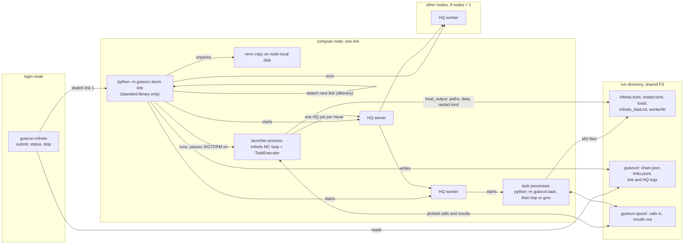
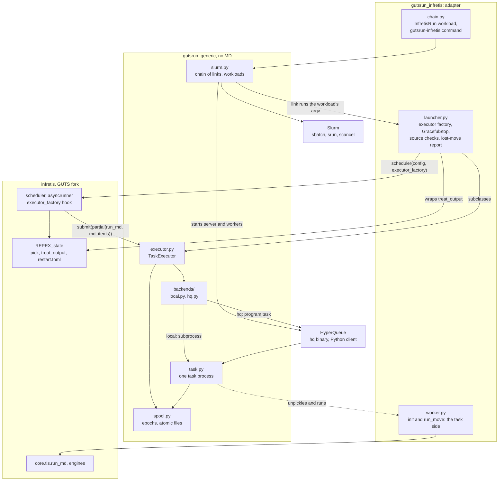
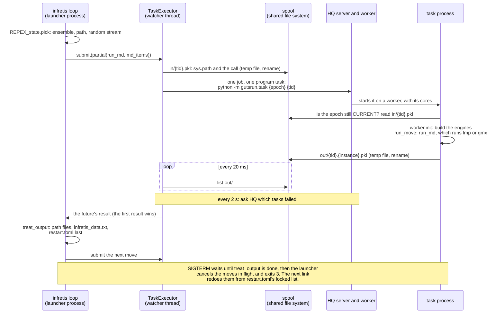

# Development

How this repository is built, tested and measured. For using it, see
[README.md](README.md).

## Background

GUTS Fast Track: make infretis usable on HPC clusters, with multi-node runs
that survive walltime limits. HQ is the Task Scheduler. Development on
DAS-6; Snellius is the first real target, LUMI and JSC later.

## Components

How this repo maps onto the GUTSnotes design:

| Component | Here |
|---|---|
| Trajectory Sampler + Result Manager | infretis's MC loop, unchanged |
| Session | the infretis run directory (`load/`, `restart.toml`, `infretis_data.txt`) |
| Task Scheduler | HQ server |
| Process Manager | HQ workers |
| Resource Manager | the chain of Slurm jobs (`gutsrun.slurm`) |
| Job Submitter | site files + `sbatch` |

The HPC part (`src/gutsrun/`) is generic and knows nothing about MD; it is
meant to grow into the shared GUTS HPC packages. Only the adapter
(`src/gutsrun_infretis/`) knows about infretis.

### Where things run

One link is one Slurm job. Everything that must outlive a job lives in the
run directory on the shared file system; everything else (HQ, the venv
copy) is started fresh by each link.



### Modules

Arrows mean "calls or imports". Nothing in `gutsrun` imports the adapter or
infretis: a task process reaches the adapter only by unpickling the call it
was given (dotted arrow).



### One move

What happens between infretis picking a move and saving its result,
with the HQ backend (the local backend starts the task process itself).



## Layout

```
flake.nix               dev shell: hq 0.26.2, Python 3.12, GROMACS, LAMMPS
pyproject.toml          the gutsrun package (src/), the gutsrun-infretis command, pytest
requirements.txt        direct pins (infretis, inftools, hyperqueue client)
requirements-lock.txt   exact versions, installed by setup-venv.sh
scripts/get-hq.sh       pinned hq binary into ./bin, for clusters without Nix
scripts/setup-venv.sh   .venv from the lock file, plus this checkout (editable)
scripts/sync.sh         rsync the repo to a login node, pull runs/<site>/ back
scripts/wait-jobs.sh    poll a login node's squeue until jobs finish, optionally pull
scripts/das6/           DAS-6 probes (login node read-only, one-node and two-node jobs);
                        install-engines.sh (GROMACS, LAMMPS from conda-forge)
sites/                  one file per cluster; template.toml documents every key
ASSUMPTIONS.md          version pins and cluster assumptions
PROVENANCE.md           where each file comes from, and under which terms
bench/bare_run.py       run bare infretis on an example, record run.json
bench/chain.py          chains of an example with either runner (the bare-vs-gutsrun rows)
bench/move_times.py     per-move time statistics from sim.log
bench/cold_start.py     cold start of a fresh infretis worker process (N at once)
bench/fs_latency.py     cross-node file visibility on a shared FS (ping-pong)
bench/hq_dispatch.py    HQ per-task round trip (program vs Python function task)
bench/executor_roundtrip.py  round trip of a trivial call through gutsrun
bench/step5.sh          each case through bare / gutsrun local / gutsrun HQ, back to back
bench/timings_summary.py  per-phase medians from gutsrun-timings.jsonl
examples/               prepared infentory cases (examples/README.md)
src/gutsrun/            generic: TaskExecutor + backends; slurm.py chains Slurm jobs (no MD imports)
src/gutsrun_infretis/   infretis adapter, launcher, chain workload and command (the only infretis-aware code)
tests/                  pytest suite (adapter tests need infretis)
```

`runs/` holds bench outputs and is not tracked.

## gutsrun

`gutsrun.TaskExecutor` is a `concurrent.futures.Executor`: each `submit`
runs as one backend task, a fresh `python -m gutsrun.task` process.

```python
from gutsrun import TaskExecutor
from gutsrun.backends.hq import HQBackend        # or backends.local.LocalBackend

ex = TaskExecutor(HQBackend(server_dir), "runs/x/spool",
                  initializer=init, initargs=(cfg,),        # runs before every call
                  resource_dict={"cores": 2})               # default per call
fut = ex.submit(fn, arg, resource_dict={"cores": 4, "cwd": "...", "env": {...}})
```

- **Spool directory**, one subdirectory per executor instance (the
  *epoch*): `in/` holds the pickled calls, `out/` the results
  (`<tid>.<instance>.pkl`, temp + rename), `log/` stdout/stderr. `CURRENT`
  names the live epoch. A new executor takes over the spool and deletes
  older epochs. Tasks of an older epoch neither start nor publish.
- **Completion** from result files (listed every 20 ms). Failures from the
  backend every 2 s (HQ: one batched `get_failed_tasks` call). The first
  result for a task wins; later ones are deleted. Files of finished
  tasks are deleted; failed tasks keep their logs.
- **HQ tasks are `program()` tasks**, not Python function tasks. They
  carry only two paths (payload rule), and need no HQ Python environment.
  HQ reruns a task after a worker crash (`crash_limit`, default 2). The
  rerun gets a new instance number.
- **Like `ProcessPoolExecutor` with spawn:** calls and results must pickle
  by reference; the caller's `sys.path` is sent along. Exceptions arrive
  with the remote traceback as `__cause__`. Unlike it, the initializer
  runs before every call.
- Both backends set `OMP_NUM_THREADS` to the task's cores (HQ does so for
  every task).

## The launcher

In an infretis run directory, instead of `infretisrun -i infretis.toml`:

```bash
.venv/bin/python -m gutsrun_infretis.launcher -i infretis.toml --backend local
HQ_SERVER_DIR=... .venv/bin/python -m gutsrun_infretis.launcher \
    -i restart.toml --backend hq --cores-per-task 2
```

or `bench/bare_run.py ... --runner gutsrun [--backend hq]`. The launcher
passes infretis a `TaskExecutor` factory (`executor_factory`, a hook in the
GUTS fork, `requirements.txt`) and adds, for this run only: a
`restart.toml` backup at start, graceful SIGTERM/SIGINT (waits out
`treat_output`), `wmdrun` pinning flags stripped under HQ, `-ntomp` checked against
`--cores-per-task`, and tasks that leave the shared GROMACS inputs alone
(each task builds its engines, while other moves read
`gromacs_input/infretis.mdp`). A task instead checks that mdp against its
engine settings and stops the run if it differs: it was edited during the
run, or two engines with different settings share one `input_path` (in
plain infretis the engine built last silently sets the mdp for all of
them). At start it refuses an infretis without the `executor_factory`
hook, and checks the source of the four infretis functions it copies or
relies on (`worker_initializer`, `REPEX_state.treat_output` and two engine
constructors) against the tested commit (the fork's `5df681e`); other
infretis versions run if those are unchanged, otherwise it stops
(`--allow-other-infretis` overrides). The fork's fixes (atomic
`restart.toml`, no busy spin in the parent, restarts from the run's seed)
apply to bare runs too. Two of the four are engine
constructors, which a task runs before every move (infretis runs them
once per worker): GROMACS's and LAMMPS's, both read at the tested commit.
The check has gaps: it covers both whichever engine a run uses, so a
change to one stops runs of the other; it does not cover the other
engines (ASE, CP2K, TurtleMD, AMS; AMS's constructor starts an
`AMSWorker`, here once per move); and it hashes the constructors, not the
helpers they call. Exit codes: 0 done, 1 an error (traceback in
`gutsrun.log` and on stderr), 3 stopped by a signal, 4 infretis refused to
start. Logs: `gutsrun.log`; moves log to
`worker{pin}.log` as before; per-move timings go to
`gutsrun-timings.jsonl` (`bench/timings_summary.py` summarises them);
the move time each stop lost goes to `gutsrun-stops.jsonl` (moves not yet
through `treat_output`, by pin, from submit to their end or the stop).

## Chains

`gutsrun.slurm` is the generic chain: what one link does, step by step, is
in its module docstring. A *workload* (a small class, see `Workload` there)
says what a link runs and how far the run got; `gutsrun_infretis.chain`
has the infretis one and the `gutsrun-infretis` command, `bench/chain.py`
one that runs `bench/bare_run.py` with either runner. A link's own process
runs `.venv/bin/python -m gutsrun.slurm link ...` and imports only the
standard library, so it reads nothing from site-packages on the shared
file system; the workload's command then runs from the node-local venv
copy. With `nodes` > 1, one srun step runs `python -m gutsrun.slurm worker`
on each of the other nodes: it unpacks that node's venv copy and starts an
HQ worker there (`run_worker`).

Bench chains on DAS-6, from the repo root on `fs0`:

```bash
.venv/bin/python bench/chain.py 2d gutsrun --steps 1000 --time 00:05:00
.venv/bin/python bench/chain.py 2d bare --steps 3000 --time 00:04:00
.venv/bin/gutsrun-infretis status runs/das6/<name>
```

To run a link without Slurm, e.g. on the laptop, `bench/chain.py
--no-submit` prepares the run and its chain and prints the spec's path;
then `GUTSRUN_LOCAL_DISK=<dir> GUTSRUN_CORES=4 .venv/bin/python -m
gutsrun.slurm link <spec> 1` runs link 1 here (inside `nix develop` for hq).
The tests do the same through `start(spec, submit_first=False)`.

## Tests

```bash
nix develop --command .venv/bin/python -m pytest          # all but slow (~1 min)
nix develop --command .venv/bin/python -m pytest -m slow  # LAMMPS exact check (~1 min)
.venv/bin/python -m pytest -m "not hq"                    # without the dev shell: gutsrun only
```

Without Nix, drop the `nix develop --command` prefix, and call ruff and
pyright as `.venv/bin/ruff` and `.venv/bin/pyright` if you installed them
there ([Getting started (local)](#getting-started-local)).

Lint and type check (both configured in `pyproject.toml`; tests are
exempt from the type-annotation rule):

```bash
nix develop --command ruff check .
nix develop --command pyright
```

The chain tests fake `sbatch`, `scancel` and `squeue` and run links as
local processes. The HQ tests start `hq server` and `hq worker` processes,
which need TCP on localhost. They cannot run inside Claude Code's sandbox.

## Getting started (local)

On any Linux x86-64 machine: a laptop, a workstation, a login node.

With Nix, the dev shell provides everything (hq 0.26.2, Python 3.12,
GROMACS, LAMMPS, ruff, pyright, jq):

```bash
nix develop
scripts/setup-venv.sh
.venv/bin/python -c 'import infretis, hyperqueue'
```

Without Nix, you need Python 3.12 and git (infretis and inftools install
from git):

```bash
PYTHON=python3.12 scripts/setup-venv.sh
scripts/get-hq.sh                  # the same pinned hq, into bin/
export PATH="$PWD/bin:$PATH"       # tests look for hq on PATH; chain links find bin/hq themselves
.venv/bin/python -c 'import infretis, hyperqueue'
```

The rest of what the dev shell provides, and what needs it:

| Needed for | Without Nix |
|---|---|
| tests marked `hq` | `hq` on `PATH`, as above; without it run `pytest -m "not hq"` |
| the slow exact check | `lmp` with REAXFF and QEQ on `PATH`, e.g. conda-forge `lammps` (`scripts/das6/install-engines.sh` shows one install) |
| GROMACS examples (`puckering`) | `gmx` on `PATH` |
| lint and type check | `.venv/bin/python -m pip install ruff pyright`. Not pinned, so versions may differ from the dev shell's; the PyPI `pyright` downloads Node.js on first use |
| `scripts/wait-jobs.sh --run` | `jq` |

On NixOS without the dev shell, pip's wheels (numpy, mdtraj) do not find
`libstdc++` and `zlib`: use `nix develop`.

## DAS-6 workflow

The login node (`fs0`) is reachable only from a university network or
through eduVPN. Code goes there with `scripts/sync.sh <host> push` (which
writes `REVISION`, since `.git` is not copied), and `runs/das6/` comes back
with `pull`. `scripts/wait-jobs.sh <host> <jobid>` (or `--run <rundir>` for a
chain) waits on the laptop until jobs are done.
