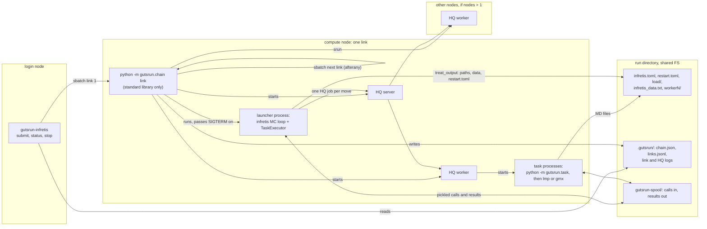
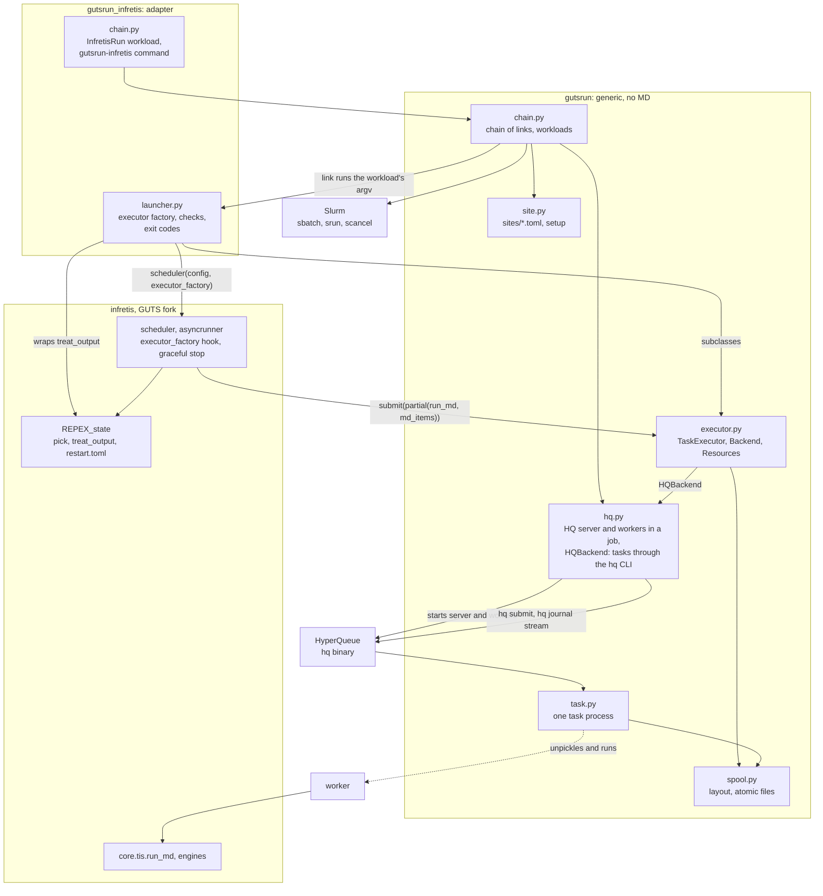
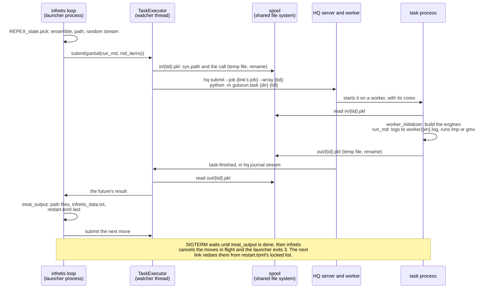

# Development

How this repository is built, tested and measured. For using it, see
[README.md](README.md).

## Background

GUTS Fast Track: make infretis usable on HPC clusters, with multi-node runs
that survive walltime limits. HQ is the Task Scheduler. Development on
DAS-6; Snellius is the first real target, LUMI and JSC later.

## Components

How this repo maps onto the GUTSnotes design:

| Component | Here |
|---|---|
| Trajectory Sampler + Result Manager | infretis's MC loop, unchanged |
| Session | the infretis run directory (`load/`, `restart.toml`, `infretis_data.txt`) |
| Task Scheduler | HQ server |
| Process Manager | HQ workers |
| Resource Manager | the chain of Slurm jobs (`gutsrun.chain`, with `gutsrun.hq`) |
| Job Submitter | site files + `sbatch` |

The HPC part (`src/gutsrun/`) is generic and knows nothing about MD; it is
meant to grow into the shared GUTS HPC packages. Only the adapter
(`src/gutsrun_infretis/`) knows about infretis.

### Where things run

One link is one Slurm job. Everything that must outlive a job lives in the
run directory on the shared file system; everything else (HQ) is
started fresh by each link.



### Modules

Arrows mean "calls or imports". Nothing in `gutsrun` imports the adapter or
infretis: a task process reaches the adapter only by unpickling the call it
was given (dotted arrow).



### One move

What happens between infretis picking a move and saving its result,
each one an HQ task.



## Layout

```
flake.nix               dev shell: hq 0.26.2, Python 3.12, GROMACS, LAMMPS
pyproject.toml          the gutsrun package (src/), the gutsrun-infretis command, pytest
requirements.txt        direct pins (infretis, inftools)
requirements-lock.txt   exact versions, installed by setup-venv.sh
scripts/get-hq.sh       pinned hq binary into ./bin, for clusters without Nix
scripts/setup-venv.sh   .venv from the lock file, plus this checkout (editable)
scripts/sync.sh         rsync the repo to a login node, pull runs/<site>/ back
scripts/wait-jobs.sh    poll a login node's squeue until jobs finish, optionally pull
scripts/das6/           probe-login.sh (what the login node has, read-only);
                        install-engines.sh (GROMACS, LAMMPS from conda-forge)
sites/                  one file per cluster; template.toml documents every key
ASSUMPTIONS.md          version pins and cluster assumptions
PROVENANCE.md           where each file comes from, and under which terms
bench/bare_run.py       run bare infretis on an example, record run.json
bench/chain.py          chains of an example with either runner (the bare-vs-gutsrun rows)
bench/move_times.py     per-move time statistics from sim.log
examples/               prepared infentory cases (examples/README.md)
src/gutsrun/            generic: TaskExecutor; hq.py runs its tasks on HQ; chain.py chains Slurm jobs; site.py (no MD imports)
src/gutsrun_infretis/   infretis adapter, launcher, chain workload and command (the only infretis-aware code)
tests/                  pytest suite (adapter tests need infretis)
```

`runs/` holds bench outputs and is not tracked.

## gutsrun

`gutsrun.TaskExecutor` is a `concurrent.futures.Executor`: each `submit`
runs as one HQ task, a fresh `python -m gutsrun.task` process. The
`Backend` protocol in `executor.py` is the seam between the two: the
tests use fake backends there.

```python
from gutsrun import TaskExecutor
from gutsrun.hq import HQBackend

ex = TaskExecutor(HQBackend(server_dir), "runs/x/spool",
                  initializer=init, initargs=(cfg,),        # runs before every call
                  resource_dict={"cores": 2})               # default per call
fut = ex.submit(fn, arg, resource_dict={"cores": 4, "cwd": "...", "env": {...}})
```

- **Spool directory**, one subdirectory per executor instance: `in/`
  holds the pickled calls, `out/` the results (`<tid>.pkl`, temp +
  rename), `log/` stdout/stderr (`<tid>.<instance>.{out,err}`; HQ deletes
  them when the task finishes, `:rm-if-finished`, and keeps those of
  failed and cancelled tasks). A new executor deletes the older
  subdirectories, so a queued task of an older executor (after a killed
  launcher on a long-lived HQ server) fails without running. One that
  already runs keeps running its move in `worker{pin}/` and fails only
  when it publishes: cancel such tasks (`hq job cancel all`) before
  starting a launcher on that server. A directory a stale task still has
  files open in can stay behind (on NFS, as `.nfs*` files) until a later
  executor removes it. In a chain none of this happens: each link has a
  fresh HQ server, and Slurm ends a link's tasks with its job.
- **HQ through its CLI only.** `HQBackend` opens one HQ job (`hq job
  open`) and submits each call as the task of that job whose id is the
  executor's task id (`hq submit --job J --array <tid>`): a program task
  carrying two paths (payload rule), which needs no HQ Python package. One
  `hq journal stream` reports when tasks end; it replays every event since
  the server started, so a restarted stream misses nothing. The event
  format is HQ's own: check it when upgrading HQ. HQ 0.26.2 cancels whole
  jobs only, so shutting down cancels the job (`hq job cancel J
  --reason ...`), with SIGINT to each task's process group. HQ reruns a
  task after a worker crash (`crash_limit`, default 2); the rerun gets a
  new instance number.
- **Completion** from the backend (under HQ, `task-finished` events): the
  executor then reads `out/<tid>.pkl`, retrying for up to 60 s in case the
  shared file system shows it late. Inputs and results of ended tasks are
  deleted.
- **Errors:** a call that raises (or whose value does not pickle) makes
  the task write its traceback to stderr, and its last ~1,900 characters
  to `$HQ_ERROR_FILENAME` (with `--task-dir`), and exit 1. HQ reports that
  text in the `task-failed` event, and the future fails with
  `TaskFailed("task <tid>: <traceback>")`, naming the stderr log. The
  caller gets a message, not the call's own exception: nothing in infretis
  or gutsrun depends on the type.
- **`--time-request`** (`HQBackend(time_request=...)`, off by default): a
  worker with less time left than that does not start the task. A worker
  inside a Slurm job is expected to take its end time from Slurm (not
  yet checked on DAS-6).
- **Like `ProcessPoolExecutor` with spawn:** calls and results must pickle
  by reference; the caller's `sys.path` is sent along. Unlike it, the
  initializer runs before every call, and failures arrive as `TaskFailed`.
- HQ sets `OMP_NUM_THREADS` to the task's cores for every task.

## The launcher

In an infretis run directory, instead of `infretisrun -i infretis.toml`:

```bash
.venv/bin/python -m gutsrun_infretis.launcher -i infretis.toml
HQ_SERVER_DIR=... .venv/bin/python -m gutsrun_infretis.launcher \
    -i restart.toml --cores-per-task 2 [--time-request 30m]
```

or `bench/bare_run.py ... --runner gutsrun`. Moves run on the HQ server
in `$HQ_SERVER_DIR` (a chain's link sets it). Without one, the launcher
starts its own server and a worker on all the cores it may use, for the
run (`gutsrun-hq/`, removed at the end; logs `gutsrun-hq-*.log`), in a
session of their own so that a Ctrl-C stops infretis gracefully before
HQ. There is no HQ-free mode: plain `infretisrun` is the baseline. The
launcher
passes infretis a `TaskExecutor` factory (`executor_factory`, a hook in the
GUTS fork, `requirements.txt`), which runs infretis's own worker
initializer before every move. In the fork, the initializer needs no
shared state, each move logs to `worker{pin}.log`, the workers leave the
shared GROMACS inputs alone (the parent writes them once at setup, and
refuses engines that share an `input_path` with different settings) and
stop their MD program on SIGTERM, infretis stops gracefully on
SIGTERM/SIGINT (after the result it is recording, `restart.toml` last),
and a refused setup logs why. The launcher adds, for this run only: a
`restart.toml` backup at start, and under HQ a check of `wmdrun`: no
pinning flags (HQ places the tasks), and `-ntomp` equal to
`--cores-per-task`; a `wmdrun` that fails it is refused, not rewritten. At start it refuses an
infretis without the `executor_factory` hook, the graceful stop, the
GROMACS inputs written at setup or the workers' SIGTERM handling. The
fork's other fixes (atomic `restart.toml`, no busy spin in the parent,
restarts from the run's seed) apply to bare runs too. Exit codes: 0 done
(or nothing to do), 1 an error (traceback in `gutsrun.log` and on
stderr), 3 stopped by a signal, 4 infretis refused to start (its reason
on stderr). Logs: `gutsrun.log`; moves log to `worker{pin}.log`, as
under plain infretis.

## Chains

`gutsrun.chain` is the generic chain: what one link does, step by step, is
in its module docstring. It reads the site file through `gutsrun.site` and
starts HQ through `gutsrun.hq`; neither imports it. A *workload* (a small class, see `Workload` there)
says what a link runs and how far the run got; `gutsrun_infretis.chain`
has the infretis one and the `gutsrun-infretis` command, `bench/chain.py`
one that runs `bench/bare_run.py` with either runner. A link's own process
runs `.venv/bin/python -m gutsrun.chain link ...` and imports only the
standard library, so it reads nothing from site-packages on the shared
file system; the workload's command then runs from the project venv.
The link writes the HQ server's access file (host, ports the OS picked as
free, keys) before starting the server, so with `nodes` > 1 one srun step
runs `hq worker start` directly on each of the other nodes: a worker that
starts first retries every 2 s until the server listens.

Bench chains on DAS-6, from the repo root on `fs0`:

```bash
.venv/bin/python bench/chain.py 2d gutsrun --steps 1000 --time 00:05:00
.venv/bin/python bench/chain.py 2d bare --steps 3000 --time 00:04:00
.venv/bin/gutsrun-infretis status runs/das6/<name>
```

To run a link without Slurm, e.g. on the laptop, `bench/chain.py
--no-submit` prepares the run and its chain and prints the spec's path;
then `GUTSRUN_CORES=4 .venv/bin/python -m
gutsrun.chain link <spec> 1` runs link 1 here (inside `nix develop` for hq).
The tests do the same through `start(spec, submit_first=False)`.

## Tests

```bash
nix develop --command .venv/bin/python -m pytest          # all but slow (~1 min)
nix develop --command .venv/bin/python -m pytest -m slow  # LAMMPS exact check (~1 min)
.venv/bin/python -m pytest -m "not hq"                    # without hq: chain, site, executor on fakes
```

Without Nix, drop the `nix develop --command` prefix, and call ruff and
pyright as `.venv/bin/ruff` and `.venv/bin/pyright` if you installed them
there ([Getting started (local)](#getting-started-local)).

Lint and type check (both configured in `pyproject.toml`; tests are
exempt from the type-annotation rule):

```bash
nix develop --command ruff check .
nix develop --command pyright
```

The chain tests fake `sbatch`, `scancel` and `squeue` and run links as
local processes. Every test that needs HQ is marked `hq` (conftest adds
the mark to tests using its `hq_cluster` or `make_executor` fixture, and
the launcher tests start their own server). The HQ tests start `hq server` and `hq worker` processes,
which need TCP on localhost. They cannot run inside Claude Code's sandbox.

## Getting started (local)

On any Linux x86-64 machine: a laptop, a workstation, a login node.

With Nix, the dev shell provides everything (hq 0.26.2, Python 3.12,
GROMACS, LAMMPS, ruff, pyright, jq):

```bash
nix develop
scripts/setup-venv.sh
.venv/bin/python -c 'import infretis'
```

Without Nix, you need Python 3.12 and git (infretis and inftools install
from git):

```bash
PYTHON=python3.12 scripts/setup-venv.sh
scripts/get-hq.sh                  # the same pinned hq, into bin/
export PATH="$PWD/bin:$PATH"       # tests look for hq on PATH; chain links find bin/hq themselves
.venv/bin/python -c 'import infretis'
```

The rest of what the dev shell provides, and what needs it:

| Needed for | Without Nix |
|---|---|
| tests marked `hq` | `hq` on `PATH`, as above; without it run `pytest -m "not hq"` |
| the slow exact check | `lmp` with REAXFF and QEQ on `PATH`, e.g. conda-forge `lammps` (`scripts/das6/install-engines.sh` shows one install) |
| GROMACS examples (`puckering`) | `gmx` on `PATH` |
| lint and type check | `.venv/bin/python -m pip install ruff pyright`. Not pinned, so versions may differ from the dev shell's; the PyPI `pyright` downloads Node.js on first use |
| `scripts/wait-jobs.sh --run` | `jq` |

On NixOS without the dev shell, pip's wheels (numpy, mdtraj) do not find
`libstdc++` and `zlib`: use `nix develop`.

## DAS-6 workflow

The login node (`fs0`) is reachable only from a university network or
through eduVPN. Code goes there with `scripts/sync.sh <host> push` (which
writes `REVISION`, since `.git` is not copied), and `runs/das6/` comes back
with `pull`. `scripts/wait-jobs.sh <host> <jobid>` (or `--run <rundir>` for a
chain) waits on the laptop until jobs are done.
